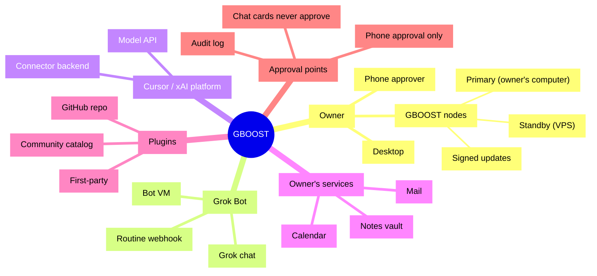

## Links

- Phone approver → Phone approval only: approves
- Grok chat → Connector backend: calls GBOOST via connector
- Grok Bot → GitHub repo: installs from
- Connector backend → GBOOST nodes: one connector, active node
